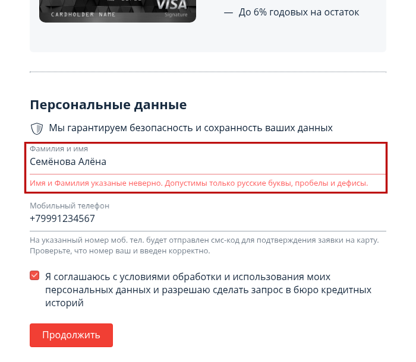

# Форма отклоняет ФИО с русской буквой «ё»

## Шаги для воспроизведения

1. Из корня проекта запустить `java -jar ./artifacts/app-order.jar -port=7777`.
2. Открыть <http://localhost:7777>.
3. В поле «Фамилия и имя» ввести `Семёнова Алёна`.
4. В поле «Мобильный телефон» ввести `+79991234567`.
5. Отметить согласие и нажать «Продолжить».

Автотест — `./gradlew test -Dsut.url=http://localhost:7777 --tests 'ru.netology.CardOrderTest.acceptsRussianLetterYo'`.

## Ожидаемый результат

Форма принимает ФИО с русской буквой «ё» и показывает сообщение «Ваша заявка успешно отправлена!».

## Фактический результат

Форма остаётся на странице заявки и подсвечивает поле ФИО. Текст ошибки в интерфейсе приведён дословно.

> Имя и Фамилия указаные неверно. Допустимы только русские буквы, пробелы и дефисы.

## Окружение и лог

- Debian GNU/Linux 13, x86_64.
- OpenJDK 11.0.29 (Zulu), Selenium 4.29.0, Chrome Headless Shell 156.0.8078.79.
- [Код теста](../../src/test/java/ru/netology/CardOrderTest.java).
- Сервис Netology `artifacts/app-order.jar`. Строка лога запуска — `INFO Application - Responding at http://0.0.0.0:7777`.
- Строка из отчёта JUnit — `AssertionFailedError: Форма отклонила ФИО с буквой ё`.
