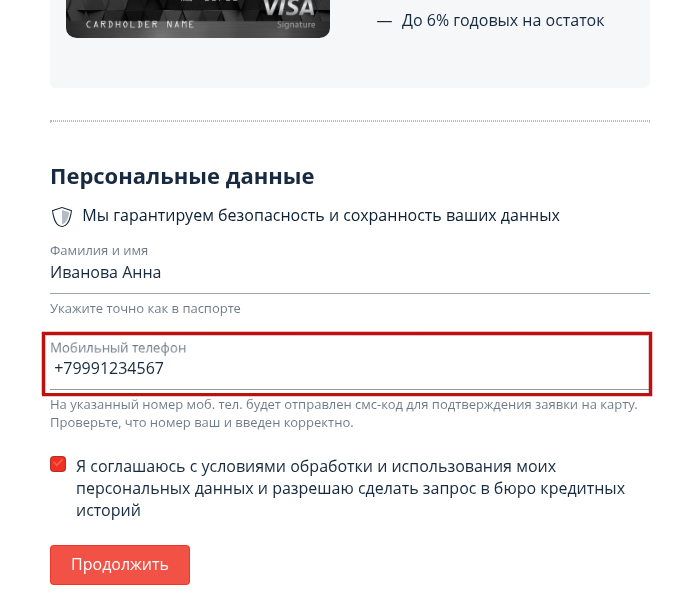
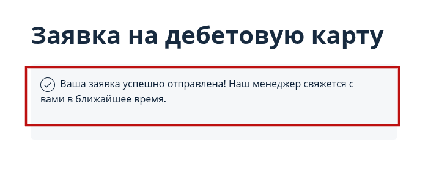

# Форма принимает телефон с пробелом перед знаком «+»

## Шаги для воспроизведения

1. Из корня проекта запустить `java -jar ./artifacts/app-order.jar -port=7777`.
2. Открыть <http://localhost:7777>.
3. В поле «Фамилия и имя» ввести `Иванова Анна`.
4. В поле «Мобильный телефон» ввести один пробел, а затем `+79991234567`.
5. Отметить согласие и нажать «Продолжить».

Автотест — `./gradlew test -Dsut.url=http://localhost:7777 --tests 'ru.netology.CardOrderTest.rejectsPhoneWithLeadingSpace'`. Перед отправкой он проверяет, что введённое значение в DOM начинается с пробела.

## Ожидаемый результат

Форма подсвечивает поле телефона и выводит ошибку формата. По условию знак `+` должен быть первым символом, а после него должно идти ровно 11 цифр.

## Фактический результат

Форма принимает телефон и показывает сообщение «Ваша заявка успешно отправлена!». Сообщение об ошибке отсутствует.

## Окружение и лог

- Debian GNU/Linux 13, x86_64.
- OpenJDK 11.0.29 (Zulu), Selenium 4.29.0, Chrome Headless Shell 156.0.8078.79.
- [Код теста](../../src/test/java/ru/netology/CardOrderTest.java).
- Сервис Netology `artifacts/app-order.jar`. Строка лога запуска — `INFO Application - Responding at http://0.0.0.0:7777`.
- Строка из отчёта JUnit — `AssertionFailedError: Форма приняла заявку с ошибкой в поле phone`.
